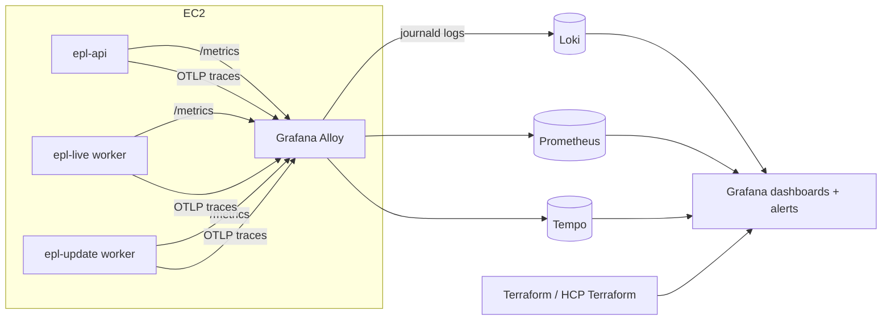
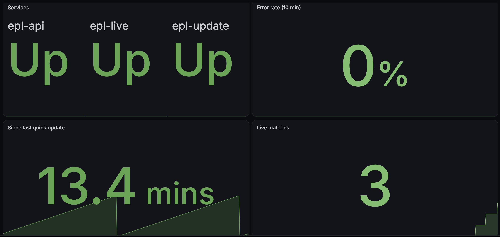
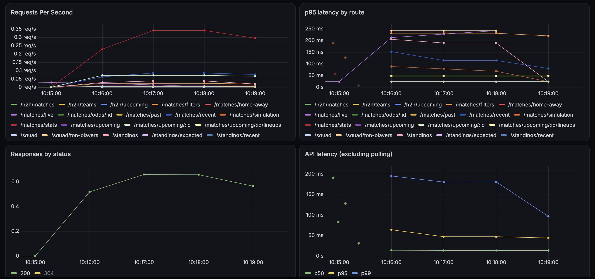
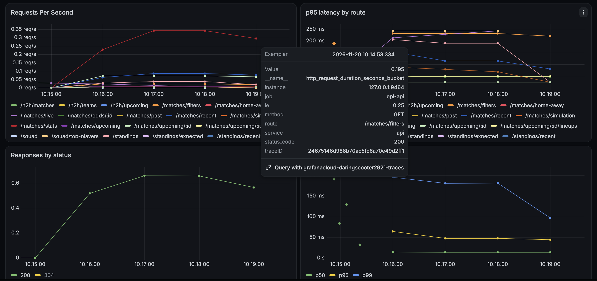
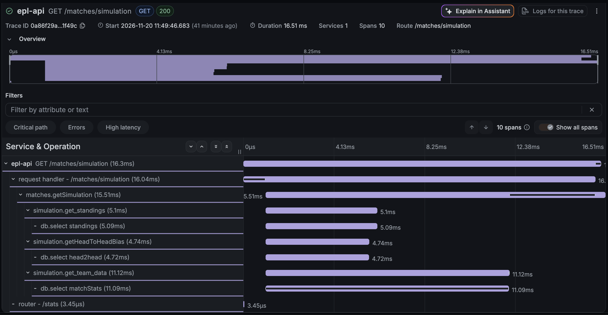

# European Football Stats

**Live site:** [eu-soccer-delta.vercel.app](https://eu-soccer-delta.vercel.app/)

A full-stack data and analytics platform for the top five European football leagues: live
scores, match stats and lineups, historical analysis, head-to-head comparisons, and
probabilistic match predictions. The project focuses on reliable data ingestion from several
sources, a normalized database covering 20+ seasons, and running the backend like a
production service, with metrics, tracing, and alerting.

---

## Overview

The app covers **20+ seasons** of the Premier League, La Liga, Serie A, Bundesliga, and
Ligue 1. A Next.js frontend talks to an Express API on AWS, and two background workers keep
the data current: one follows live matches, the other imports results, standings, fixtures,
odds, squads, and player images on a schedule.

---

## Key Features

- **Live matches**
  - Live scores, goal and card timelines, substitutions, lineups, and match stats (including xG)
  - Confirmed starting XIs as soon as they're published before kickoff

- **Large historical dataset**
  - 200+ teams, 3,000+ players, 35,000+ matches over 20+ seasons
  - Standings (home, away, and total) with recent form

- **Match history and comparisons**
  - Team match history with filters (season, venue, opponent, result, scoreline, goals)
  - Head-to-head records, team stat comparisons, and top-player leaderboards

- **Automated data pipelines**
  - Multi-source ETL from ESPN, football-data.org, The Odds API, and TheSportsDB,
    plus historical CSV data
  - Idempotent PostgreSQL upserts, data-quality checks on imported match timelines,
    and rate-limit handling for external APIs

---

## Observability

The API and both workers are fully instrumented. Grafana Alloy on the instance collects
metrics, logs, and traces and ships them to Grafana Cloud. Dashboards and alert rules are
managed as code with Terraform.



| Signal                                | What's collected                                                                                                                      |
| ------------------------------------- | ------------------------------------------------------------------------------------------------------------------------------------- |
| **Metrics** (Prometheus)              | Request latency by route, ESPN request outcomes, live-worker tick duration, update-run duration and failures, Node.js runtime metrics |
| **Logs** (Loki)                       | journald output from all three services                                                                                               |
| **Traces** (Tempo, via OpenTelemetry) | Every API request and worker run, with hand-written spans for each service function and database query                                |
| **Alerts**                            | Service down, live worker stalled, quick update overdue, API error rate above 5%                                                      |

### Service overview

All three services, the API error rate, time since the last scheduled update, and live
matches in progress.



### Production dashboard

Traffic, latency by route, and response codes. Server-side p95 stays around 25 ms under load.



### Exemplars

Latency panels use **exemplars**: each dot on the chart is a real request, and clicking it
opens that request's trace.



### Request trace

One match simulation request. The three data lookups run in parallel, then the gap at the
end is the 10,000-run Monte Carlo simulation itself.



### Infrastructure as code

The Grafana folder, dashboard, alert rules, and contact point live in
[`infra/grafana`](infra/grafana) and are applied through HCP Terraform. Every pull request
touching that folder runs `terraform fmt`, `validate`, and `plan` in GitHub Actions.

### Load test

A [k6](load-test/api.js) script simulates users browsing the home page, a match preview, and
a team page, with random leagues, seasons, teams, and real fixture IDs taken from the API's own
responses: **p95 77 ms, 0% errors** over 3,400 requests at up to 20 concurrent users.

---

## Tech Stack

**Frontend:** Next.js 16, React 19, TypeScript, Redux Toolkit (RTK Query), Tailwind CSS v4, Sonner

**Backend:** Node.js, Express, TypeScript, Zod, Drizzle ORM

**Database:** PostgreSQL (Supabase)

**Infrastructure:** AWS (EC2, API Gateway, VPC), Vercel, systemd

**Observability:** OpenTelemetry, Prometheus, Grafana Cloud (Loki, Tempo), Grafana Alloy, k6

**Tooling:** pnpm workspaces (shared types between client and server), Terraform / HCP Terraform,
GitHub Actions, Dependabot, ESLint

**Data sources:** ESPN, football-data.org, The Odds API, TheSportsDB, historical CSV files

---

## Project Structure

```text
client/          Next.js frontend
server/          Express API, live and update workers, database schema (Drizzle)
shared/          Types shared by the client and server (@epl/shared)
infra/grafana/   Terraform for the Grafana dashboard, alerts, and contact point
load-test/       k6 load test
docs/images/     README screenshots
```

---

## Author

**Sean Previty**
M.S. Computer Science, University of Central Florida
GitHub: [https://github.com/seanprevity](https://github.com/seanprevity)
LinkedIn: [https://www.linkedin.com/in/sean-previty-64439b2b9/](https://www.linkedin.com/in/sean-previty-64439b2b9/)
